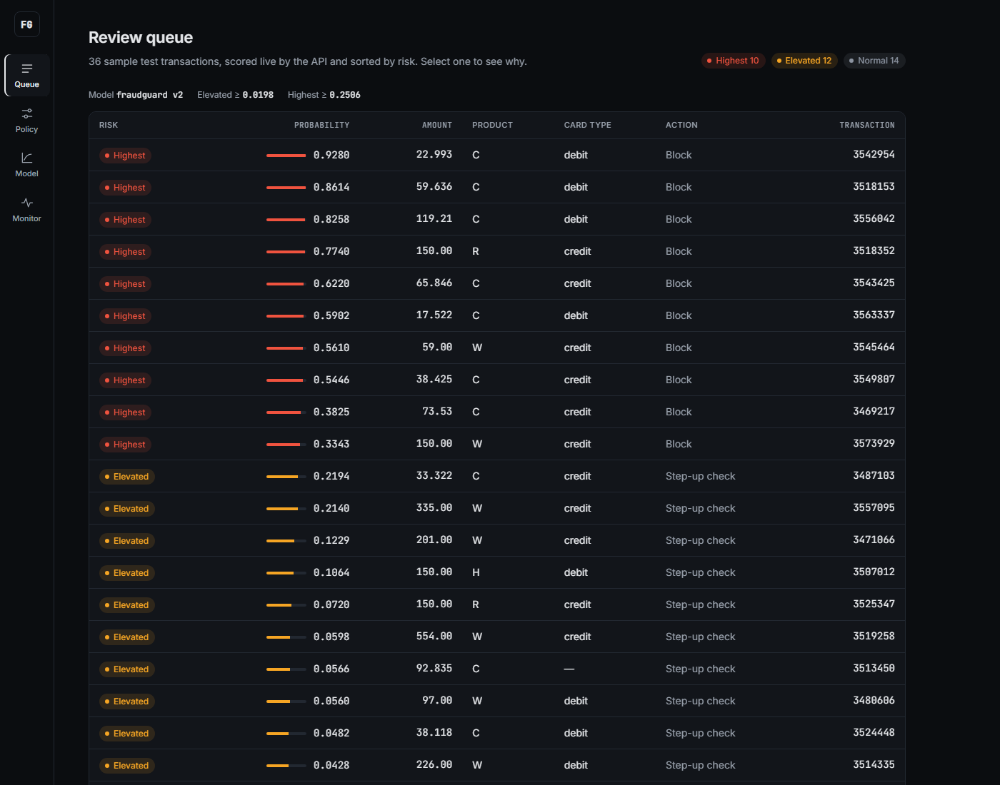
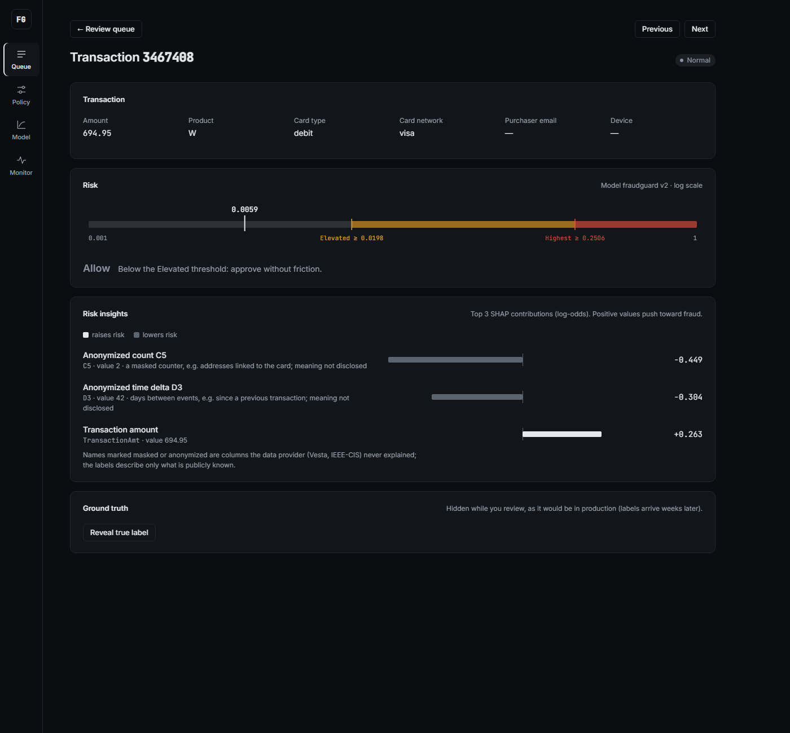
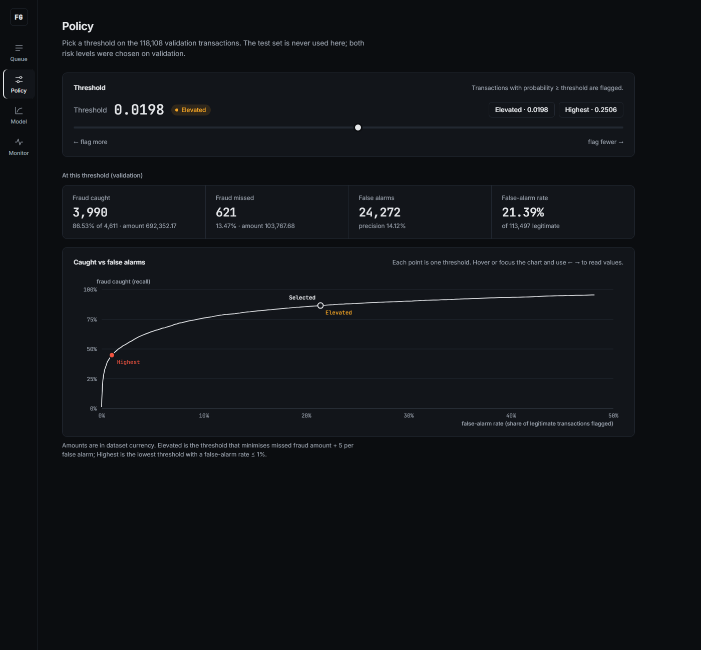
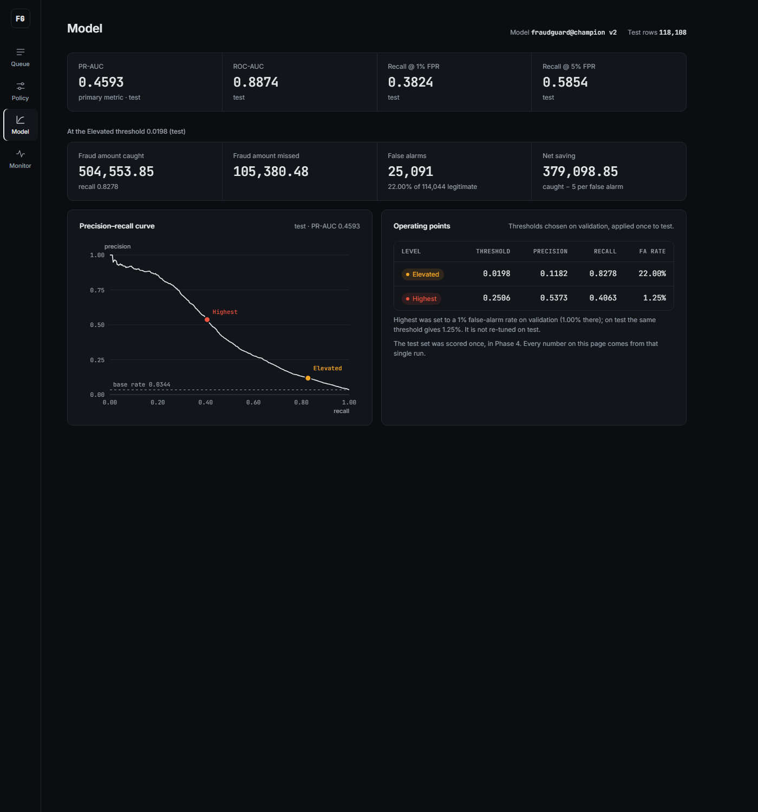
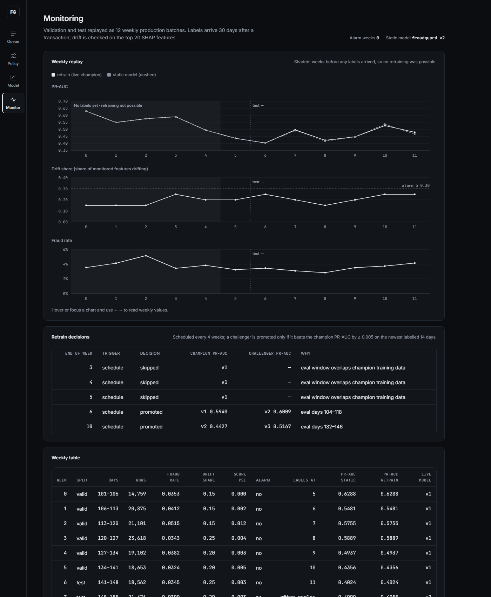
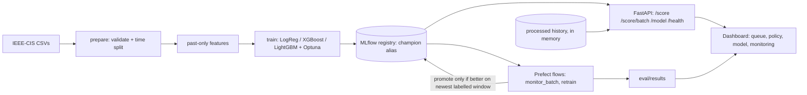

# FraudGuard

Real-time fraud scoring for digital payments, built end to end: time-honest features, tracked models, a serving API with a risk-operations dashboard, drift monitoring and label-delayed retraining. Evaluated on a held-out future period, with the weak spots reported rather than hidden.



| | |
|---|---|
|  |  |
|  |  |

Screenshots are of the dashboard served by the API at `/dashboard` (review queue, one transaction with its top reasons, the threshold policy, model results, monitoring replay).

> **Data note:** the dataset is IEEE-CIS Fraud Detection (card / e-commerce payments, 590,540 transactions, about 3.5% fraud). It is **not UPI data**, and the project makes no claim about UPI.

## Architecture



The same `build_features` function runs in training and in serving; a parity test checks that a row scored by the API gets the same features as offline.

## Key design decisions

- **Time-based split (60/20/20), not random.** Fraud patterns move over time and a random split lets the model see the future. Train is days 1-101, validation 101-141, test 141-183 (`eval/results/split.json`). A random split would have given a flattering number that production would not repeat.
- **Past-only features.** Per-card counts and amounts over 1h / 24h / 7d, time since last transaction, new device / email / address for the card, and value frequencies use only rows with a strictly earlier `TransactionDT`. A test (`test_no_future_rows_used`) checks that changing future rows changes nothing; the dataset has no user ID, so a "card" is a combination of the card fields.
- **No-future test set.** The test set was scored once, after the model, features and threshold were frozen. Everything before that used validation only.
- **V columns dropped.** The anonymised `V*` features add little: validation PR-AUC 0.5410 with V vs 0.5337 without (gap 0.0074, under the 0.02 limit set beforehand). Dropping them leaves 111 features and a smaller, simpler model to serve.
- **Threshold chosen on validation, by cost.** An assumed cost of 5 per false alarm (a cheap step-up check such as an OTP, not a blocked payment) gives a threshold of 0.0198. The test set never influenced it. The cost is an assumption; the cost-sensitivity table is in `eval/results/final_test.md`.
- **Two risk levels.** *Elevated* (probability >= 0.0198): step-up check. *Highest* (>= 0.2506, the threshold giving at most 1% false alarms on validation): block. One threshold cannot serve both a cheap action and an expensive one.
- **30-day label delay.** A fraud label (chargeback) is assumed to arrive 30 days after the transaction. Monitoring performance and retraining only use labels at least that old, so the replay does not cheat with labels a real system would not have yet. The 30 days is an assumption, set in `config/settings.yaml`.

## Results

Everything below comes from `eval/results/`.

**Validation (model selection, `models.md`)**

| model | PR-AUC | ROC-AUC | recall @1% FPR | recall @5% FPR |
|---|---|---|---|---|
| lgbm_tuned | 0.5483 | 0.9101 | 0.4424 | 0.6439 |
| **lgbm_unweighted (champion)** | 0.5477 | 0.9106 | 0.4487 | 0.6484 |
| lgbm_weighted | 0.5337 | 0.9040 | 0.4255 | 0.6376 |
| xgboost | 0.4974 | 0.8814 | 0.4032 | 0.5968 |
| logreg | 0.2805 | 0.8389 | 0.1841 | 0.3843 |

Optuna (20 trials) improved on the best default by +0.0006, below the 0.005 minimum, so the tuned model was not used.

**Test, scored once (`final_test.md`), model `fraudguard` v2, 118,108 transactions**

| metric | value |
|---|---|
| PR-AUC | 0.4593 |
| ROC-AUC | 0.8874 |
| recall @ 1% FPR | 0.3824 |
| recall @ 5% FPR | 0.5854 |
| precision / recall at threshold 0.0198 | 0.1182 / 0.8278 |
| false alarms | 25,091 (22.00% of 114,044 legitimate transactions) |
| fraud amount caught / missed | 504,553.85 / 105,380.48 |
| false alarm cost (5 each) | 125,455.00 |
| net saving | 379,098.85 |

**Test, Highest level (`highest_test.md`):** threshold 0.2506, set on validation at a 1% false alarm rate, applied to the saved test scores (no re-scoring, no re-tuning).

| metric | value |
|---|---|
| precision / recall | 0.5373 / 0.4063 |
| false alarm rate | 1.25% (1,422 false alarms; 1.00% on validation) |
| fraud caught / missed | 1,651 / 2,413 transactions |
| fraud amount caught / missed | 188,220.96 / 421,713.38 |
| net saving (5 per false alarm) | 181,110.96 |

Amounts are in the dataset's currency units. At the chosen threshold, one in five legitimate payments gets a step-up check. The stricter operating point, recall at 5% FPR, is 0.5854.

**Serving (`latency.md`):** `/score`, 300 validation rows one at a time against the Docker container: p50 281 ms, p95 531 ms, max 1544 ms.

## Honest findings

1. **Test PR-AUC is lower than validation: 0.4593 vs 0.5477.** The same model, the same threshold. I did not find the cause. Weekly replay PR-AUC was already falling inside validation (week 0: 0.6288, week 5: 0.4356) and varies between 0.4024 and 0.5361 across the test weeks (`monitoring.md`). So the 0.4593 is a realistic estimate for future data, and 0.5477 is optimistic.
2. **Drift monitoring did not detect it.** Over 12 weekly batches there were 0 alarm weeks. Drift share (Evidently, top-20 SHAP features vs train) peaked at 0.25 against a 0.30 alarm level, and the score PSI stayed at or below 0.012 against a 0.1 alarm level. Performance fell while the monitored inputs and scores looked stable, so this style of drift check alone would not have flagged it. Only labelled performance showed the drop, and labels arrive 30 days late.
3. **Retraining barely helped, because of the label delay.** Pooled over the six test weeks, the retrained model scored PR-AUC 0.4620 vs 0.4593 for the static model (+0.0027), and recall @5% FPR went down, 0.5795 vs 0.5854. Two challengers were promoted (v2 at week 6, v3 at week 10), but with 30-day-old labels each challenger is trained on data that is already about a month behind. The first three scheduled retrains were skipped, because the newest labelled window still overlapped the champion's training data.

## Known limits

- **Latency.** `/score` p50 is 281 ms and p95 531 ms, too slow for a real authorisation path. Common emails and devices match a large share of the history, so `build_features` runs over a large row subset per request. The fix is a feature store holding per-card counts and window sums, read at request time. It is not done here because it would duplicate the feature logic that training and serving share.
- **No streaming.** Scoring is request/response against an in-memory copy of the history, which scoring never updates. A real system would update per-card state as events arrive (for example Kafka plus a feature store). That is planned as future work, not built.
- **Not UPI data.** IEEE-CIS is card / e-commerce data. Fields, fraud patterns and the delay between transaction and label differ for UPI.
- **Assumed costs and delay.** The 5-per-false-alarm cost and the 30-day label delay are assumptions, not measurements.
- **Test-time monitoring is a replay.** Weekly batches over validation and test, not a live system; the Prefect flows are written to run on a schedule but were only run as a replay.
- **Dataset time is relative.** `TransactionDT` is seconds from an unknown start, so "days" are offsets, not calendar dates.

## Run it on Windows

Needs Python 3.12, [uv](https://docs.astral.sh/uv/) and, for the container, Docker Desktop. The data is not in the repository: download `train_transaction.csv` and `train_identity.csv` from the [IEEE-CIS Fraud Detection](https://www.kaggle.com/c/ieee-fraud-detection/data) competition (free Kaggle account, accept the rules) into `data/raw/`.

```powershell
uv sync
uv run python -m fraudguard.data.prepare          # validate + time split
uv run python -m fraudguard.models.train          # models, Optuna, MLflow registry (champion)
uv run python -m fraudguard.models.final_eval     # scores the test set; run once
uv run python -m fraudguard.models.dashboard_export
uv run python -m fraudguard.models.highest_test   # Highest-level test numbers, from saved scores
uv run python -m fraudguard.pipelines.flows       # monitoring + retraining replay
uv run pytest -q
uv run ruff check .
```

Serve locally:

```powershell
uv run uvicorn fraudguard.serving.app:app --port 8000
```

Or with Docker (after the steps above, since `mlflow.db`, `mlruns/`, `data/processed/` and `eval/results/` are mounted read-only):

```powershell
docker compose up --build
```

- API: http://localhost:8000/docs (`/score`, `/score/batch`, `/health`, `/model`)
- Dashboard: http://localhost:8000/dashboard
- MLflow UI: http://localhost:5000

CI (`.github/workflows/ci.yml`) runs ruff and the offline tests on every push with a CPU-only install. The end-to-end serving test skips itself when the data and registry are absent.

More detail: `docs/EDA.md`, `docs/ERROR_ANALYSIS.md`, `docs/MONITORING.md`.
