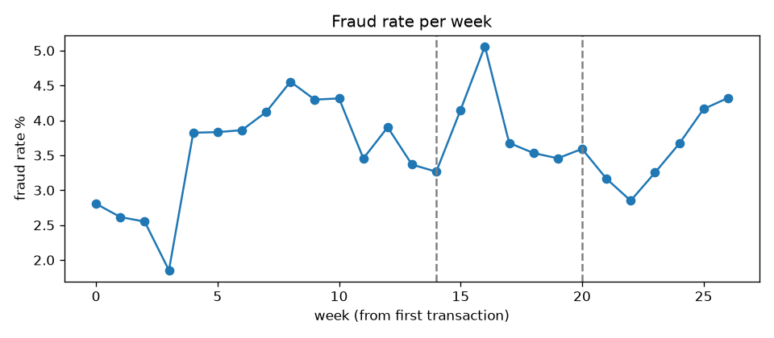
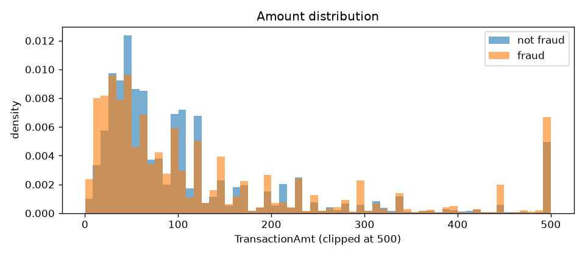

# EDA (auto-generated by `scripts/eda.py`)

Dataset: IEEE-CIS Fraud Detection (card / e-commerce digital payments, not UPI).
`TransactionDT` is seconds from an unknown start; days below are offsets, not calendar dates.

## Overview
- 590,540 transactions, 434 columns (after merge, excl. helper columns), fraud rate 3.50%
- Time span: day 1 to day 182
- Rows with identity data: 24.4% (fraud rate 7.85% with identity vs 2.09% without)

## Time-based split (boundaries in `eval/results/split.json`)
| split | rows | fraud_rate |
|---|---|---|
| train | 354324 | 3.38% |
| valid | 118108 | 3.9% |
| test | 118108 | 3.44% |

Dashed lines mark where validation and test start.

## Missing values
214 columns are more than 50% missing. Top 10:

| column | missing_% |
|---|---|
| id_24 | 99.2 |
| id_25 | 99.1 |
| id_08 | 99.1 |
| id_07 | 99.1 |
| id_21 | 99.1 |
| id_26 | 99.1 |
| id_22 | 99.1 |
| id_27 | 99.1 |
| id_23 | 99.1 |
| dist2 | 93.6 |

## Key patterns
Fraud rate by `ProductCD`:

| ProductCD | rows | fraud_rate |
|---|---|---|
| W | 439670 | 2.04% |
| C | 68519 | 11.69% |
| R | 37699 | 3.78% |
| H | 33024 | 4.77% |
| S | 11628 | 5.9% |

By `card4` (network):

| card4 | rows | fraud_rate |
|---|---|---|
| visa | 384767 | 3.48% |
| mastercard | 189217 | 3.43% |
| american express | 8328 | 2.87% |
| discover | 6651 | 7.73% |

By `card6` (type):

| card6 | rows | fraud_rate |
|---|---|---|
| debit | 439938 | 2.43% |
| credit | 148986 | 6.68% |
| debit or credit | 30 | 0.0% |
| charge card | 15 | 0.0% |

By `P_emaildomain` (top 8 by volume):

| P_emaildomain | rows | fraud_rate |
|---|---|---|
| gmail.com | 228355 | 4.35% |
| yahoo.com | 100934 | 2.28% |
| hotmail.com | 45250 | 5.3% |
| anonymous.com | 36998 | 2.32% |
| aol.com | 28289 | 2.18% |
| comcast.net | 7888 | 3.12% |
| icloud.com | 6267 | 3.14% |
| outlook.com | 5096 | 9.46% |

Amount, fraud vs not (mean / median):

| isFraud | mean | median |
|---|---|---|
| 0 | 134.51 | 68.5 |
| 1 | 149.24 | 75.0 |

